<p align="center">
  
</p>

<p align="center">
  
</p>

<p align="center">
  
</p>

<p align="center">
  
  
  
  
  
  
</p>

---

## Overview

**MONKz DEOBF** brings multiple Lua and Luau deobfuscation engines and code cleanup utilities together into one clean, responsive website. Every tool lives on its own dedicated page with swipeable tabs, custom illustrated SVG logos, smooth transitions, and background Web Worker execution so your browser stays responsive.

---

## Processing Pipeline

```mermaid
flowchart LR
    A[Input Script] --> B[Detector]
    B --> C[Deobfuscator Engine]
    C --> D[Basic Cleaner]
    D --> E[Beautifier]
    E --> F[Clean Output]

    style A fill:#0f172a,stroke:#38bdf8,stroke-width:2px,color:#f8fafc
    style B fill:#1e1b4b,stroke:#818cf8,stroke-width:2px,color:#f8fafc
    style C fill:#312e81,stroke:#a78bfa,stroke-width:2px,color:#f8fafc
    style D fill:#164e63,stroke:#22d3ee,stroke-width:2px,color:#f8fafc
    style E fill:#064e3b,stroke:#34d399,stroke-width:2px,color:#f8fafc
    style F fill:#0f172a,stroke:#38bdf8,stroke-width:2px,color:#f8fafc
```



1. **Input Script:** Load code via **Drag & Drop**, **File Picker**, or paste directly into the text box.
2. **Detector:** Scans for known markers, flags visible loaders, network calls, and Discord webhooks, and offers a one-click shortcut to the suggested tool.
3. **Deobfuscator Engine:** Runs in background browser Web Workers (with cancel support and a 60-second limit) or Pyodide / optional Vercel Python.
4. **Basic Cleaner:** Decodes escaped strings, numeric `string.char` calls, and simple constant math.
5. **Beautifier:** Fixes indentation and line breaks so you can copy or download clean, readable Lua/Luau.

---

## Deobfuscators

| Logo | Name | What It Targets | Status | Runs In |
| :---: | :--- | :--- | :---: | :---: |
|  | **Prometheus** | Prometheus and WeAreDevs scripts | Tested on 14 public samples | Browser |
|  | **LuaObfuscator** | LuaObfuscator.com output | Experimental | Browser |
|  | **Clyde** | Clyde Protection output | Experimental | Browser |
|  | **Ironveil V1** | Ironveil V1 output | Tested with 1 sample | Browser |
|  | **Hercules** | Hercules VM and BytecodeEncoder payloads | Partly tested | Browser, optional server |

> [!NOTE]
> **Hercules Compatibility:** The engine returned output for **7 of 9** bundled samples in standard Python. Browser mode (via Pyodide) is not yet verified, and an optional Vercel Python server mode is available when needed.

> [!NOTE]
> **Prometheus testing:** All 14 samples from public sample collections produced output, and the browser output matched the command line engine. 2 of them reported warnings, so their output is partial. The output was not compared with the original programs.

<details>
<summary><b>Engine Details and Runtime Notes</b></summary>

- **Browser Web Worker Engines (`Prometheus`, `LuaObfuscator`, `Clyde`, `Ironveil V1`):** Execute completely client-side in isolated background threads with a 60-second execution limit and instant cancellation.
- **Hercules (`Pyodide` + Optional `Vercel Python`):** Defaults to running Python inside your browser via Pyodide (`cdn.jsdelivr.net`). You can optionally switch to server mode to run on the site's Vercel Python function.

</details>

---

## Sandbox Executor


Runs a script inside a browser sandbox with fake Roblox objects and shows **what it tries to do**: calls, property changes, web requests, `loadstring` layers and decoded strings.

- Runs in a separate Web Worker. The Lua code has no access to the network, files or the page
- Limits on steps, time, text size and loops, with cancel and partial results
- It does not rebuild source code, and it is **not** a Roblox executor: it cannot inject into games
- Not supported: `coroutine.yield`, some Luau syntax (inline `if` expressions, backtick strings) and binary bytecode. Some scripts detect the sandbox and stop

| Family | Samples with results |
| :--- | :---: |
| IronBrew 2 | 6 of 12 |
| Synapse Xen | 4 of 12 |
| JayFuscator | 2 of 2 |
| Hercules | 3 of 9 |
| Prometheus | 2 of 12 |
| IronBrew 1 | 1 of 12 |
| 2hbj | 1 of 12 |
| GoofyScator, LeakD, wYnFuscate | 0 of 12, 0 of 10, 0 of 12 |
| Luraph, MoonSec | 0 of 10, 0 of 3 |

Random samples from each family. A sample counts when the sandbox recorded 5 or more actions. This does not mean the whole script was recovered, and results were not compared with original programs.

---

## Utilities

| Logo | Name | What It Does |
| :---: | :--- | :--- |
|  | **Detector** | Recognizes **25 obfuscator families** by headers and code structure. For the ones this site can deobfuscate, a shortcut carries your script to the tool. Also flags **loaders**, **network calls**, and **Discord webhooks** it can see. |
|  | **Beautifier** | Fixes indentation and line breaks to format compressed or messy scripts. |
|  | **Basic Cleaner** | Decodes escaped strings, numeric `string.char` calls, and simple constant math. |

### Code Cleanup Examples

<details open>
<summary><b>1. Basic Cleaner + Beautifier (Strings, Math, and Formatting)</b></summary>

**Before:**

```lua
local _0x1=string.char(72,101,108,108,111)
local _0x2=(10+5)*2 if _0x2>20 then print("\x4f\x4b") end
```

**After:**

```lua
local _0x1 = "Hello"
local _0x2 = 30
if _0x2 > 20 then
  print("OK")
end
```

</details>

<details>
<summary><b>2. Detector (Triage and Suspicious Pattern Flagging)</b></summary>

The **Detector** scans incoming scripts for known obfuscator signatures and highlights potentially risky patterns it can spot statically:
- **Obfuscator Signatures:** Names 25 families. Signatures for 23 of them matched sample files. Most rely on headers, so a script with its header removed may not be identified.
- **Shortcut:** Offers the matching deobfuscator when this site has one. Detection alone does not mean the script can be deobfuscated.
- **Loaders:** Flags dynamic `loadstring` / loader patterns.
- **Network Calls & Webhooks:** Flags visible HTTP requests and Discord webhook URLs for manual review.

</details>

---

## Features and Visual Effects

<table>
  <tr>
    <td width="50%" valign="top">
      <h4>Navigation &amp; Workflow</h4>
      <ul>
        <li><b>A page for every tool</b>, with swipeable tool tabs</li>
        <li><b>Upload or paste:</b> Drag &amp; Drop, File Picker, or text box</li>
        <li><b>Copy and download</b> results, or send them straight to the <b>Beautifier</b></li>
        <li><b>Detector shortcut</b> that carries your script to the suggested tool</li>
      </ul>
    </td>
    <td width="50%" valign="top">
      <h4>Performance, Style &amp; Motion</h4>
      <ul>
        <li><b>Background processing</b> for browser engines, with cancel and a 60 second limit</li>
        <li><b>Dark and light themes</b> with a responsive layout for phones and desktops</li>
        <li><b>Site icon and an original illustrated logo</b> for every tool</li>
        <li><b>Animations:</b> decoding text effect, page and card transitions, and a progress bar while an engine runs (reduced when your device asks for <code>prefers-reduced-motion</code>)</li>
      </ul>
    </td>
  </tr>
</table>

---

## Execution Modes Comparison

| Mode | Tools | Where It Runs | Data & Network Behavior |
| :--- | :--- | :--- | :--- |
| **Browser (Web Workers)** | Prometheus, LuaObfuscator, Clyde, Ironveil V1, Detector, Beautifier, Basic Cleaner | Local background thread in your browser | **No uploads** — script stays on your device |
| **Browser (Pyodide)** | Hercules (Default) | Python runtime in your browser | Pyodide loads from `cdn.jsdelivr.net`; script stays local |
| **Server Mode (Optional)** | Hercules (Optional) | Site's Vercel Python function | Script is sent only if you select server mode; not saved or logged by app code |

---

## Privacy and Safety

> [!TIP]
> **Local-First Processing:** Browser tools process your script on your device. This site does not upload it for processing.

- **Hercules runs in the browser** with Pyodide, loaded from `cdn.jsdelivr.net`. Only if you choose server mode is your script sent to the site's Python function. The application code does not save or log it. The hosting provider may keep technical request logs.

> [!WARNING]
> **Review Before Use:**
> - Decoded output may be incomplete or behave differently from the original. Always review it before running.
> - **A script with no warnings is not necessarily safe.**

---

## Built With

<p align="center">
  
</p>

| Layer | Technologies |
| :--- | :--- |
| **Interface & Styling** | HTML, CSS, JavaScript (dark/light themes, swipeable tabs, custom SVG logos, CSS animations) |
| **Background Execution** | Web Workers (non-blocking browser processing with cancel & 60s timeout) |
| **In-Browser Python** | Pyodide (Python in the browser via `cdn.jsdelivr.net`) |
| **Optional Serverless** | Python function on Vercel |

---

## Quick FAQ

<details>
<summary><b>Why is there a 60-second limit on browser engines?</b></summary>

Heavy obfuscated scripts can stall a tab. Running engines inside Web Workers with a 60-second limit and a cancel button keeps the UI responsive.

</details>

<details>
<summary><b>Does the site respect reduced motion settings?</b></summary>

Yes. The decoding text effect, page/card transitions, and progress animations automatically reduce motion when your device requests `prefers-reduced-motion`.

</details>

<details>
<summary><b>Is my script uploaded anywhere?</b></summary>

No—unless you explicitly choose server mode for **Hercules**, all processing happens locally in your browser.

</details>

---

## Credits

| Engine | Author | License |
| :--- | :--- | :---: |
| Sandbox Executor interpreter and parser (from Prometheus Deobfuscator, with fixes applied at run time) | LeakD | [MIT](vendor/licenses/prometheus.txt) |
| [Prometheus Deobfuscator](https://github.com/prostone4/Prometheus-Deobfuscator) | LeakD ([leakd.fr](https://leakd.fr)) | [MIT](vendor/licenses/prometheus.txt) |
| LuaObfuscator Deobfuscator | LeakD / Prostone | [MIT](vendor/licenses/luaobfuscator.txt) |
| ClydeDeobf | `@_jmi.` (OmniDBF) | [MIT](vendor/licenses/clyde.txt) |
| Ironveil Deobfuscator *(unused eval helper removed)* | LeakD / `prostone_` | [MIT](vendor/licenses/ironveil.txt) |
| deobfhercules | see license | [Apache 2.0](vendor/licenses/hercules.txt) |

---

<p align="center">
  
</p>
