&lt;!-- Animated Neon Wave Hero --&gt;
&lt;p align=&quot;center&quot;&gt;
  &lt;img src=&quot;https://capsule-render.vercel.app/api?type=waving&amp;color=0:020617,30:1e1b4b,65:4f46e5,100:06b6d4&amp;height=230&amp;section=header&amp;text=MONKz%20DEOBF&amp;fontSize=58&amp;fontColor=ffffff&amp;animation=fadeIn&amp;fontAlignY=35&amp;desc=Lua%20%26%20Luau%20Deobfuscation%20Suite&amp;descAlignY=59&amp;descSize=18&quot; width=&quot;100%&quot; alt=&quot;MONKz DEOBF Animated Banner&quot; /&gt;
&lt;/p&gt;

&lt;!-- Project Logo --&gt;
&lt;p align=&quot;center&quot;&gt;
  &lt;img src=&quot;favicon.svg&quot; width=&quot;104&quot; alt=&quot;MONKz DEOBF Logo&quot; /&gt;
&lt;/p&gt;

&lt;!-- Animated Cyber Display Font Banner (Orbitron) --&gt;
&lt;p align=&quot;center&quot;&gt;
  &lt;img src=&quot;https://readme-typing-svg.demolab.com?font=Orbitron&amp;weight=700&amp;size=22&amp;duration=2500&amp;pause=1000&amp;color=38BDF8&amp;center=true&amp;vCenter=true&amp;width=760&amp;height=42&amp;lines=LUA+%26+LUAU+DEOBFUSCATION+IN+ONE+CLEAN+WEBSITE;5+ENGINES+%E2%80%A2+3+UTILITIES+%E2%80%A2+100%25+CLIENT-SIDE&quot; alt=&quot;Orbitron Animated Title&quot; /&gt;
&lt;/p&gt;

&lt;!-- Animated Terminal Decoding Effect (JetBrains Mono + Dark Card Background) --&gt;
&lt;p align=&quot;center&quot;&gt;
  &lt;img src=&quot;https://readme-typing-svg.demolab.com?font=JetBrains+Mono&amp;weight=500&amp;size=15&amp;duration=2200&amp;pause=850&amp;color=34D399&amp;background=0B1120&amp;center=true&amp;vCenter=true&amp;width=760&amp;height=46&amp;lines=%5B+%3E_%20%5D+Scanning+markers+%E2%86%92+Prometheus+%7C+LuaObfuscator+%7C+Clyde+%7C+Ironveil+%7C+Hercules;%5B+%3E_%20%5D+Running+in+Web+Workers+(60s+limit)+%26+Pyodide+WASM+runtime;%5B+%3E_%20%5D+Detector+%E2%80%A2+Beautifier+%E2%80%A2+Basic+Cleaner+%E2%80%94+Zero+Server+Uploads&quot; alt=&quot;Terminal Decoding Animation&quot; /&gt;
&lt;/p&gt;

&lt;!-- Branded Tech &amp; Feature Badges with Logos --&gt;
&lt;p align=&quot;center&quot;&gt;
  &lt;img src=&quot;https://img.shields.io/badge/Lua_%26_Luau-2C2D72?style=for-the-badge&amp;logo=lua&amp;logoColor=white&quot; alt=&quot;Lua and Luau&quot; /&gt;
  &lt;img src=&quot;https://img.shields.io/badge/Client--Side_Workers-0EA5E9?style=for-the-badge&amp;logo=googlechrome&amp;logoColor=white&quot; alt=&quot;Client-Side Web Workers&quot; /&gt;
  &lt;img src=&quot;https://img.shields.io/badge/Pyodide_WASM-3776AB?style=for-the-badge&amp;logo=webassembly&amp;logoColor=white&quot; alt=&quot;Pyodide WASM&quot; /&gt;
  &lt;img src=&quot;https://img.shields.io/badge/Optional_Vercel_API-000000?style=for-the-badge&amp;logo=vercel&amp;logoColor=white&quot; alt=&quot;Vercel&quot; /&gt;
  &lt;img src=&quot;https://img.shields.io/badge/Dark_%26_Light_UI-6366F1?style=for-the-badge&amp;logo=css3&amp;logoColor=white&quot; alt=&quot;Dark and Light Themes&quot; /&gt;
&lt;/p&gt;

&lt;!-- Animated Neon Divider --&gt;
&lt;p align=&quot;center&quot;&gt;
  &lt;img src=&quot;https://capsule-render.vercel.app/api?type=rect&amp;color=0:020617,25:38bdf8,50:818cf8,75:38bdf8,100:020617&amp;height=4&quot; width=&quot;85%&quot; alt=&quot;Neon Divider&quot; /&gt;
&lt;/p&gt;

&lt;br /&gt;

## Processing Pipeline

**MONKz DEOBF** runs a clean, local-first pipeline from obfuscated input to readable Lua/Luau output:

```mermaid
flowchart LR
    A["Input Script<br/>Drag & Drop • File • Paste"] --> B["Detector<br/>Markers • Loaders • Webhooks"]
    B -->|One-Click Shortcut| C["Deobfuscator<br/>Web Worker (60s) / Pyodide"]
    C --> D["Basic Cleaner<br/>Escapes • string.char • Math"]
    D --> E["Beautifier<br/>Indentation & Line Breaks"]
    E --> F["Final Output<br/>Copy • Download • Inspect"]

    style A fill:#0f172a,stroke:#38bdf8,stroke-width:2px,color:#f8fafc
    style B fill:#1e1b4b,stroke:#818cf8,stroke-width:2px,color:#f8fafc
    style C fill:#312e81,stroke:#a78bfa,stroke-width:2px,color:#f8fafc
    style D fill:#164e63,stroke:#22d3ee,stroke-width:2px,color:#f8fafc
    style E fill:#064e3b,stroke:#34d399,stroke-width:2px,color:#f8fafc
    style F fill:#0f172a,stroke:#38bdf8,stroke-width:2px,color:#f8fafc
```



&lt;br /&gt;

## Deobfuscators

| Logo | Engine | What It Targets | Status | Runs In |
| :---: | :--- | :--- | :---: | :---: |
| &lt;img src=&quot;logos/prometheus.svg&quot; width=&quot;44&quot; alt=&quot;Prometheus Logo&quot; /&gt; | **Prometheus** | Prometheus-protected scripts |  |  |
| &lt;img src=&quot;logos/luaobfuscator.svg&quot; width=&quot;44&quot; alt=&quot;LuaObfuscator Logo&quot; /&gt; | **LuaObfuscator** | LuaObfuscator.com output |  |  |
| &lt;img src=&quot;logos/clyde.svg&quot; width=&quot;44&quot; alt=&quot;Clyde Logo&quot; /&gt; | **Clyde** | Clyde Protection output |  |  |
| &lt;img src=&quot;logos/ironveil.svg&quot; width=&quot;44&quot; alt=&quot;Ironveil V1 Logo&quot; /&gt; | **Ironveil V1** | Ironveil V1 output |  |  |
| &lt;img src=&quot;logos/hercules.svg&quot; width=&quot;44&quot; alt=&quot;Hercules Logo&quot; /&gt; | **Hercules** | Hercules VM &amp; BytecodeEncoder payloads |  |   |

> [!NOTE]
> **Hercules Note:** The engine returned output for **7 of 9** bundled samples in standard Python. Browser mode (via Pyodide) is not yet verified.

&lt;br /&gt;

## Utilities

| Logo | Utility | What It Does |
| :---: | :--- | :--- |
| &lt;img src=&quot;logos/detector.svg&quot; width=&quot;44&quot; alt=&quot;Detector Logo&quot; /&gt; | **Detector** | Scans for known obfuscator markers and suggests a tool with a direct shortcut. Also flags **loaders**, **network calls**, and **Discord webhooks** it can see. |
| &lt;img src=&quot;logos/beautifier.svg&quot; width=&quot;44&quot; alt=&quot;Beautifier Logo&quot; /&gt; | **Beautifier** | Fixes indentation and line breaks for clean, readable Lua/Luau code. |
| &lt;img src=&quot;logos/cleaner.svg&quot; width=&quot;44&quot; alt=&quot;Basic Cleaner Logo&quot; /&gt; | **Basic Cleaner** | Decodes escaped strings, numeric `string.char` calls, and simple constant math. |

&lt;details open&gt;
&lt;summary&gt;&lt;b&gt;Live Code Cleanup Preview (Basic Cleaner + Beautifier)&lt;/b&gt;&lt;/summary&gt;
&lt;br /&gt;

&lt;table&gt;
  &lt;tr&gt;
    &lt;th width=&quot;50%&quot;&gt;Before (Obfuscated / Minified)&lt;/th&gt;
    &lt;th width=&quot;50%&quot;&gt;After (Cleaned &amp;amp; Beautified)&lt;/th&gt;
  &lt;/tr&gt;
  &lt;tr&gt;
    &lt;td&gt;

```lua
local _0x1=string.char(72,101,108,108,111)
local _0x2=(10+5)*2 if _0x2>20 then print("\x4f\x4b") end
```

&lt;/td&gt;
    &lt;td&gt;

```lua
local _0x1 = "Hello"
local _0x2 = 30
if _0x2 > 20 then
  print("OK")
end
```

&lt;/td&gt;
  &lt;/tr&gt;
&lt;/table&gt;

&lt;/details&gt;

&lt;br /&gt;

## Features &amp; UI Effects

&lt;table&gt;
  &lt;tr&gt;
    &lt;td width=&quot;50%&quot; valign=&quot;top&quot;&gt;
      &lt;h3&gt;Workspace &amp;amp; Controls&lt;/h3&gt;
      &lt;ul&gt;
        &lt;li&gt;&lt;b&gt;Dedicated Tool Pages:&lt;/b&gt; A focused page for every tool with &lt;b&gt;swipeable tool tabs&lt;/b&gt;.&lt;/li&gt;
        &lt;li&gt;&lt;b&gt;Flexible Input:&lt;/b&gt; &lt;kbd&gt;Drag &amp;amp; Drop&lt;/kbd&gt;, &lt;kbd&gt;File Picker&lt;/kbd&gt;, or direct text box paste.&lt;/li&gt;
        &lt;li&gt;&lt;b&gt;Instant Actions:&lt;/b&gt; &lt;b&gt;Copy&lt;/b&gt; and &lt;b&gt;Download&lt;/b&gt; results, or send them straight to the &lt;b&gt;Beautifier&lt;/b&gt;.&lt;/li&gt;
        &lt;li&gt;&lt;b&gt;Detector Shortcut:&lt;/b&gt; Automatically carries your script to the suggested tool.&lt;/li&gt;
      &lt;/ul&gt;
    &lt;/td&gt;
    &lt;td width=&quot;50%&quot; valign=&quot;top&quot;&gt;
      &lt;h3&gt;Animations, Style &amp;amp; Speed&lt;/h3&gt;
      &lt;ul&gt;
        &lt;li&gt;&lt;b&gt;Background Workers:&lt;/b&gt; Browser engines run in Web Workers with &lt;b&gt;cancel support&lt;/b&gt; and a &lt;b&gt;60s limit&lt;/b&gt;.&lt;/li&gt;
        &lt;li&gt;&lt;b&gt;Dark &amp;amp; Light Themes:&lt;/b&gt; Responsive layout tailored for both &lt;b&gt;phones and desktops&lt;/b&gt;.&lt;/li&gt;
        &lt;li&gt;&lt;b&gt;Original Tool Logos:&lt;/b&gt; Site icon and a custom illustrated SVG logo for every tool.&lt;/li&gt;
        &lt;li&gt;&lt;b&gt;Built-in Motion Effects:&lt;/b&gt; Decoding text effect, page/card transitions, and live progress bar (respects &lt;code&gt;prefers-reduced-motion&lt;/code&gt;).&lt;/li&gt;
      &lt;/ul&gt;
    &lt;/td&gt;
  &lt;/tr&gt;
&lt;/table&gt;

&lt;br /&gt;

## Privacy &amp; Safety

> [!TIP]
> **Local-First Processing:** Browser tools process your script directly on your device. This site does not upload it for processing.

- **Hercules Execution:** Runs in the browser with **Pyodide**, loaded from `cdn.jsdelivr.net`. Only if you choose server mode is your script sent to the site's Python function. The application code does not save or log it, though the hosting provider may keep technical request logs.

> [!WARNING]
> **Analyze Carefully:** Decoded output may be incomplete or behave differently from the original—always review it before use. A script with no warnings is not necessarily safe.

&lt;br /&gt;

## Built With

&lt;p align=&quot;center&quot;&gt;
  &lt;img src=&quot;https://www.google.com/search?q=https://skillicons.dev/icons%3Fi%3Dhtml,css,js,py,wasm,vercel&quot; alt=&quot;HTML, CSS, JavaScript, Python, WebAssembly, Vercel&quot; /&gt;
&lt;/p&gt;

&lt;p align=&quot;center&quot;&gt;
  &lt;b&gt;HTML&lt;/b&gt; • &lt;b&gt;CSS&lt;/b&gt; • &lt;b&gt;JavaScript&lt;/b&gt; • &lt;b&gt;Web Workers&lt;/b&gt; • &lt;b&gt;Pyodide&lt;/b&gt; (Python in the browser) • &lt;b&gt;Optional Vercel Python Function&lt;/b&gt;
&lt;/p&gt;

&lt;br /&gt;

## Credits

&lt;details open&gt;
&lt;summary&gt;&lt;b&gt;Engine Authors &amp;amp; Open Source Licenses&lt;/b&gt;&lt;/summary&gt;
&lt;br /&gt;

| Engine | Author | License |
| :--- | :--- | :---: |
| **Prometheus Deobfuscator** | LeakD | [MIT](https://www.google.com/search?q=vendor/licenses/prometheus.txt) |
| **LuaObfuscator Deobfuscator** | LeakD / Prostone | [MIT](https://www.google.com/search?q=vendor/licenses/luaobfuscator.txt) |
| **ClydeDeobf** | `@_jmi.` (OmniDBF) | [MIT](https://www.google.com/search?q=vendor/licenses/clyde.txt) |
| **Ironveil Deobfuscator** *(unused eval helper removed)* | LeakD / `prostone_` | [MIT](https://www.google.com/search?q=vendor/licenses/ironveil.txt) |
| **deobfhercules** | See license | [Apache 2.0](https://www.google.com/search?q=vendor/licenses/hercules.txt) |

&lt;/details&gt;

&lt;!-- Animated Twinkling Wave Footer --&gt;
&lt;p align=&quot;center&quot;&gt;
  &lt;img src=&quot;https://capsule-render.vercel.app/api?type=waving&amp;color=0:06b6d4,35:4f46e5,70:1e1b4b,100:020617&amp;height=130&amp;section=footer&amp;animation=twinkling&amp;text=Use%20only%20on%20your%20own%20code%20or%20code%20you%20have%20permission%20to%20analyze.&amp;fontSize=15&amp;fontColor=ffffff&amp;fontAlignY=65&quot; width=&quot;100%&quot; alt=&quot;Footer Banner&quot; /&gt;
&lt;/p&gt;
