&lt;!-- Animated Gradient Wave Hero --&gt;
&lt;p align=&quot;center&quot;&gt;
  &lt;img src=&quot;https://capsule-render.vercel.app/api?type=waving&amp;color=0:020617,30:1e1b4b,65:4f46e5,100:06b6d4&amp;height=220&amp;section=header&amp;text=MONKz%20DEOBF&amp;fontSize=56&amp;fontColor=ffffff&amp;animation=fadeIn&amp;fontAlignY=36&amp;desc=Lua%20and%20Luau%20Deobfuscation%20Tools%20in%20One%20Clean%20Website&amp;descAlignY=60&amp;descSize=17&quot; width=&quot;100%&quot; alt=&quot;MONKz DEOBF Banner&quot; /&gt;
&lt;/p&gt;

&lt;!-- Project Logo --&gt;
&lt;p align=&quot;center&quot;&gt;
  &lt;img src=&quot;favicon.svg&quot; width=&quot;104&quot; alt=&quot;MONKz DEOBF logo&quot; /&gt;
&lt;/p&gt;

&lt;!-- Fancy Display Font Animation (Orbitron) --&gt;
&lt;p align=&quot;center&quot;&gt;
  &lt;img src=&quot;https://readme-typing-svg.demolab.com?font=Orbitron&amp;weight=700&amp;size=21&amp;duration=2500&amp;pause=950&amp;color=38BDF8&amp;center=true&amp;vCenter=true&amp;width=760&amp;height=42&amp;lines=LUA+AND+LUAU+DEOBFUSCATION+SUITE;5+ENGINES+%E2%80%A2+3+UTILITIES+%E2%80%A2+CLIENT-SIDE+FIRST&quot; alt=&quot;Orbitron Display Font Animation&quot; /&gt;
&lt;/p&gt;

&lt;!-- Terminal Decoding Font Animation (JetBrains Mono + Dark Card) --&gt;
&lt;p align=&quot;center&quot;&gt;
  &lt;img src=&quot;https://readme-typing-svg.demolab.com?font=JetBrains+Mono&amp;weight=600&amp;size=16&amp;duration=2400&amp;pause=850&amp;color=34D399&amp;background=0F172A&amp;center=true&amp;vCenter=true&amp;width=760&amp;height=48&amp;lines=Prometheus+-+LuaObfuscator+-+Clyde+-+Ironveil+V1+-+Hercules;Background+Web+Workers+(60s+limit)+and+Pyodide+in+Browser;Detector+-+Beautifier+-+Basic+Cleaner+-+Zero+Server+Uploads&quot; alt=&quot;JetBrains Mono Terminal Animation&quot; /&gt;
&lt;/p&gt;

&lt;!-- Branded Badges --&gt;
&lt;p align=&quot;center&quot;&gt;
  &lt;img src=&quot;https://img.shields.io/badge/Lua_%26_Luau-2C2D72?style=for-the-badge&amp;logo=lua&amp;logoColor=white&quot; alt=&quot;Lua and Luau&quot; /&gt;
  &lt;img src=&quot;https://www.google.com/search?q=https://img.shields.io/badge/5\_Deobfuscators-4F46E5%3Fstyle%3Dfor-the-badge&quot; alt=&quot;5 Deobfuscators&quot; /&gt;
  &lt;img src=&quot;https://www.google.com/search?q=https://img.shields.io/badge/3\_Utilities-0891B2%3Fstyle%3Dfor-the-badge&quot; alt=&quot;3 Utilities&quot; /&gt;
  &lt;img src=&quot;https://img.shields.io/badge/Client--Side-10B981?style=for-the-badge&amp;logo=googlechrome&amp;logoColor=white&quot; alt=&quot;Client-Side&quot; /&gt;
  &lt;img src=&quot;https://img.shields.io/badge/Web_Workers-6366F1?style=for-the-badge&amp;logo=javascript&amp;logoColor=white&quot; alt=&quot;Web Workers&quot; /&gt;
  &lt;img src=&quot;https://img.shields.io/badge/Pyodide_WASM-3776AB?style=for-the-badge&amp;logo=python&amp;logoColor=white&quot; alt=&quot;Pyodide&quot; /&gt;
  &lt;img src=&quot;https://img.shields.io/badge/Dark_%26_Light_UI-0F172A?style=for-the-badge&amp;logo=css3&amp;logoColor=white&quot; alt=&quot;Dark and Light Themes&quot; /&gt;
&lt;/p&gt;

&lt;!-- Neon Gradient Divider --&gt;
&lt;p align=&quot;center&quot;&gt;
  &lt;img src=&quot;https://capsule-render.vercel.app/api?type=rect&amp;color=0:020617,25:38bdf8,50:818cf8,75:38bdf8,100:020617&amp;height=4&quot; width=&quot;85%&quot; alt=&quot;Neon Divider&quot; /&gt;
&lt;/p&gt;

&lt;br /&gt;

## Overview

**MONKz DEOBF** brings multiple Lua and Luau deobfuscation engines and code cleanup utilities together into one clean, responsive website. Every tool lives on its own dedicated page with swipeable tabs, custom illustrated SVG logos, smooth transitions, and background Web Worker execution so your browser stays responsive.

---

## Processing Pipeline

```mermaid
flowchart LR
    A[Input Script] --> B[Detector]
    B --> C[Deobfuscator Engine]
    C --> D[Basic Cleaner]
    D --> E[Beautifier]
    E --> F[Clean Output]

    style A fill:#0f172a,stroke:#38bdf8,stroke-width:2px,color:#f8fafc
    style B fill:#1e1b4b,stroke:#818cf8,stroke-width:2px,color:#f8fafc
    style C fill:#312e81,stroke:#a78bfa,stroke-width:2px,color:#f8fafc
    style D fill:#164e63,stroke:#22d3ee,stroke-width:2px,color:#f8fafc
    style E fill:#064e3b,stroke:#34d399,stroke-width:2px,color:#f8fafc
    style F fill:#0f172a,stroke:#38bdf8,stroke-width:2px,color:#f8fafc
```



1. **Input Script:** Load code via &lt;kbd&gt;Drag &amp; Drop&lt;/kbd&gt;, &lt;kbd&gt;File Picker&lt;/kbd&gt;, or paste directly into the text box.
2. **Detector:** Scans for known markers, flags visible loaders, network calls, and Discord webhooks, and offers a one-click shortcut to the suggested tool.
3. **Deobfuscator Engine:** Runs in background browser Web Workers (with cancel support and a 60-second limit) or Pyodide / optional Vercel Python.
4. **Basic Cleaner:** Decodes escaped strings, numeric `string.char` calls, and simple constant math.
5. **Beautifier:** Fixes indentation and line breaks so you can copy or download clean, readable Lua/Luau.

---

## Deobfuscators

| Logo | Name | What It Targets | Status | Runs In |
| :---: | :--- | :--- | :---: | :---: |
| &lt;img src=&quot;logos/prometheus.svg&quot; width=&quot;44&quot; alt=&quot;Prometheus&quot; /&gt; | **Prometheus** | Prometheus-protected scripts |  |  |
| &lt;img src=&quot;logos/luaobfuscator.svg&quot; width=&quot;44&quot; alt=&quot;LuaObfuscator&quot; /&gt; | **LuaObfuscator** | LuaObfuscator.com output |  |  |
| &lt;img src=&quot;logos/clyde.svg&quot; width=&quot;44&quot; alt=&quot;Clyde&quot; /&gt; | **Clyde** | Clyde Protection output |  |  |
| &lt;img src=&quot;logos/ironveil.svg&quot; width=&quot;44&quot; alt=&quot;Ironveil V1&quot; /&gt; | **Ironveil V1** | Ironveil V1 output |  |  |
| &lt;img src=&quot;logos/hercules.svg&quot; width=&quot;44&quot; alt=&quot;Hercules&quot; /&gt; | **Hercules** | Hercules VM and BytecodeEncoder payloads |  |   |

> [!NOTE]
> **Hercules Compatibility:** The engine returned output for **7 of 9** bundled samples in standard Python. Browser mode (via Pyodide) is not yet verified, and an optional Vercel Python server mode is available when needed.

&lt;details&gt;
&lt;summary&gt;&lt;b&gt;Engine Details &amp;amp; Runtime Notes&lt;/b&gt;&lt;/summary&gt;

- **Browser Web Worker Engines (`Prometheus`, `LuaObfuscator`, `Clyde`, `Ironveil V1`):** Execute completely client-side in isolated background threads with a 60-second execution limit and instant cancellation.
- **Hercules (`Pyodide` + Optional `Vercel Python`):** Defaults to running Python inside your browser via Pyodide (`cdn.jsdelivr.net`). You can optionally switch to server mode to run on the site's Vercel Python function.

&lt;/details&gt;

---

## Utilities

| Logo | Name | What It Does |
| :---: | :--- | :--- |
| &lt;img src=&quot;logos/detector.svg&quot; width=&quot;44&quot; alt=&quot;Detector&quot; /&gt; | **Detector** | Looks for known markers and suggests a tool, with a shortcut that carries your script straight to it. Also flags **loaders**, **network calls**, and **Discord webhooks** it can see. |
| &lt;img src=&quot;logos/beautifier.svg&quot; width=&quot;44&quot; alt=&quot;Beautifier&quot; /&gt; | **Beautifier** | Fixes indentation and line breaks to format compressed or messy scripts. |
| &lt;img src=&quot;logos/cleaner.svg&quot; width=&quot;44&quot; alt=&quot;Basic Cleaner&quot; /&gt; | **Basic Cleaner** | Decodes escaped strings, numeric `string.char` calls, and simple constant math. |

### Code Cleanup Examples

&lt;details open&gt;
&lt;summary&gt;&lt;b&gt;1. Basic Cleaner + Beautifier (Strings, Math &amp;amp; Formatting)&lt;/b&gt;&lt;/summary&gt;

**Before:**

```lua
local _0x1=string.char(72,101,108,108,111)
local _0x2=(10+5)*2 if _0x2>20 then print("\x4f\x4b") end
```

**After:**

```lua
local _0x1 = "Hello"
local _0x2 = 30
if _0x2 > 20 then
  print("OK")
end
```

&lt;/details&gt;

&lt;details&gt;
&lt;summary&gt;&lt;b&gt;2. Detector (Triage &amp;amp; Suspicious Pattern Flagging)&lt;/b&gt;&lt;/summary&gt;

The **Detector** scans incoming scripts for known obfuscator signatures and highlights potentially risky patterns it can spot statically:
- **Obfuscator Markers:** Suggests the matching deobfuscator and provides a one-click shortcut carrying your script over.
- **Loaders:** Flags dynamic `loadstring` / loader patterns.
- **Network Calls &amp; Webhooks:** Flags visible HTTP requests and Discord webhook URLs for manual review.

&lt;/details&gt;

---

## Features &amp; Visual Effects

&lt;table&gt;
  &lt;tr&gt;
    &lt;td width=&quot;50%&quot; valign=&quot;top&quot;&gt;
      &lt;h4&gt;Navigation &amp;amp; Workflow&lt;/h4&gt;
      &lt;ul&gt;
        &lt;li&gt;&lt;b&gt;A page for every tool&lt;/b&gt;, with swipeable tool tabs&lt;/li&gt;
        &lt;li&gt;&lt;b&gt;Upload or paste:&lt;/b&gt; &lt;kbd&gt;Drag &amp;amp; Drop&lt;/kbd&gt;, &lt;kbd&gt;File Picker&lt;/kbd&gt;, or text box&lt;/li&gt;
        &lt;li&gt;&lt;b&gt;Copy and download&lt;/b&gt; results, or send them straight to the &lt;b&gt;Beautifier&lt;/b&gt;&lt;/li&gt;
        &lt;li&gt;&lt;b&gt;Detector shortcut&lt;/b&gt; that carries your script to the suggested tool&lt;/li&gt;
      &lt;/ul&gt;
    &lt;/td&gt;
    &lt;td width=&quot;50%&quot; valign=&quot;top&quot;&gt;
      &lt;h4&gt;Performance, Style &amp;amp; Motion&lt;/h4&gt;
      &lt;ul&gt;
        &lt;li&gt;&lt;b&gt;Background processing&lt;/b&gt; for browser engines, with cancel and a 60 second limit&lt;/li&gt;
        &lt;li&gt;&lt;b&gt;Dark and light themes&lt;/b&gt; with a responsive layout for phones and desktops&lt;/li&gt;
        &lt;li&gt;&lt;b&gt;Site icon and an original illustrated logo&lt;/b&gt; for every tool&lt;/li&gt;
        &lt;li&gt;&lt;b&gt;Animations:&lt;/b&gt; decoding text effect, page and card transitions, and a progress bar while an engine runs (reduced when your device asks for &lt;code&gt;prefers-reduced-motion&lt;/code&gt;)&lt;/li&gt;
      &lt;/ul&gt;
    &lt;/td&gt;
  &lt;/tr&gt;
&lt;/table&gt;

---

## Execution Modes Comparison

| Mode | Tools | Where It Runs | Data &amp; Network Behavior |
| :--- | :--- | :--- | :--- |
| **Browser (Web Workers)** | Prometheus, LuaObfuscator, Clyde, Ironveil V1, Detector, Beautifier, Basic Cleaner | Local background thread in your browser | **No uploads** — script stays on your device |
| **Browser (Pyodide)** | Hercules (Default) | Python runtime in your browser | Pyodide loads from `cdn.jsdelivr.net`; script stays local |
| **Server Mode (Optional)** | Hercules (Optional) | Site's Vercel Python function | Script is sent only if you select server mode; not saved or logged by app code |

---

## Privacy and Safety

> [!TIP]
> **Local-First Processing:** Browser tools process your script on your device. This site does not upload it for processing.

- **Hercules runs in the browser** with Pyodide, loaded from `cdn.jsdelivr.net`. Only if you choose server mode is your script sent to the site's Python function. The application code does not save or log it. The hosting provider may keep technical request logs.

> [!WARNING]
> **Review Before Use:**
> - Decoded output may be incomplete or behave differently from the original. Always review it before running.
> - **A script with no warnings is not necessarily safe.**

---

## Built With

&lt;p align=&quot;center&quot;&gt;
  &lt;img src=&quot;https://www.google.com/search?q=https://skillicons.dev/icons%3Fi%3Dhtml,css,js,py,wasm,vercel&quot; alt=&quot;HTML, CSS, JavaScript, Python, WebAssembly, Vercel&quot; /&gt;
&lt;/p&gt;

| Layer | Technologies |
| :--- | :--- |
| **Interface &amp; Styling** | HTML, CSS, JavaScript (dark/light themes, swipeable tabs, custom SVG logos, CSS animations) |
| **Background Execution** | Web Workers (non-blocking browser processing with cancel &amp; 60s timeout) |
| **In-Browser Python** | Pyodide (Python in the browser via `cdn.jsdelivr.net`) |
| **Optional Serverless** | Python function on Vercel |

---

## Quick FAQ

&lt;details&gt;
&lt;summary&gt;&lt;b&gt;Why is there a 60-second limit on browser engines?&lt;/b&gt;&lt;/summary&gt;

Heavy obfuscated scripts can stall a tab. Running engines inside Web Workers with a 60-second limit and a cancel button keeps the UI responsive.

&lt;/details&gt;

&lt;details&gt;
&lt;summary&gt;&lt;b&gt;Does the site respect reduced motion settings?&lt;/b&gt;&lt;/summary&gt;

Yes. The decoding text effect, page/card transitions, and progress animations automatically reduce motion when your device requests `prefers-reduced-motion`.

&lt;/details&gt;

&lt;details&gt;
&lt;summary&gt;&lt;b&gt;Is my script uploaded anywhere?&lt;/b&gt;&lt;/summary&gt;

No—unless you explicitly choose server mode for **Hercules**, all processing happens locally in your browser.

&lt;/details&gt;

---

## Credits

| Engine | Author | License |
| :--- | :--- | :---: |
| Prometheus Deobfuscator | LeakD | [MIT](https://www.google.com/search?q=vendor/licenses/prometheus.txt) |
| LuaObfuscator Deobfuscator | LeakD / Prostone | [MIT](https://www.google.com/search?q=vendor/licenses/luaobfuscator.txt) |
| ClydeDeobf | `@_jmi.` (OmniDBF) | [MIT](https://www.google.com/search?q=vendor/licenses/clyde.txt) |
| Ironveil Deobfuscator *(unused eval helper removed)* | LeakD / `prostone_` | [MIT](https://www.google.com/search?q=vendor/licenses/ironveil.txt) |
| deobfhercules | see license | [Apache 2.0](https://www.google.com/search?q=vendor/licenses/hercules.txt) |

---

&lt;!-- Animated Twinkling Wave Footer --&gt;
&lt;p align=&quot;center&quot;&gt;
  &lt;img src=&quot;https://capsule-render.vercel.app/api?type=waving&amp;color=0:06b6d4,50:4f46e5,100:0f172a&amp;height=120&amp;section=footer&amp;animation=twinkling&amp;text=Use%20only%20on%20your%20own%20code%20or%20code%20you%20have%20permission%20to%20analyze.&amp;fontSize=14&amp;fontColor=ffffff&amp;fontAlignY=65&quot; width=&quot;100%&quot; alt=&quot;Footer Banner&quot; /&gt;
&lt;/p&gt;
